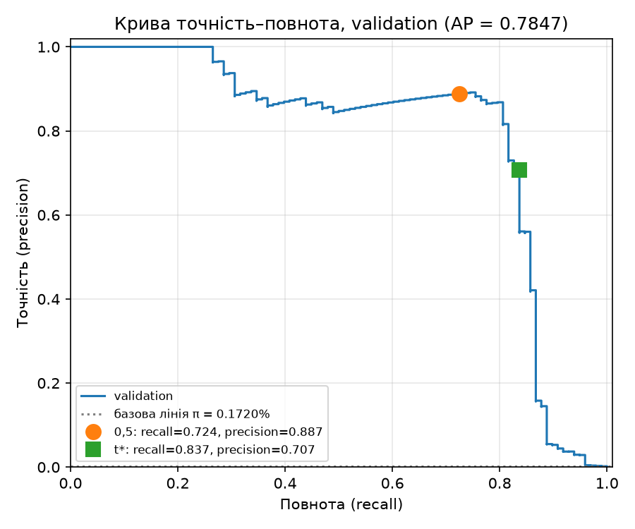
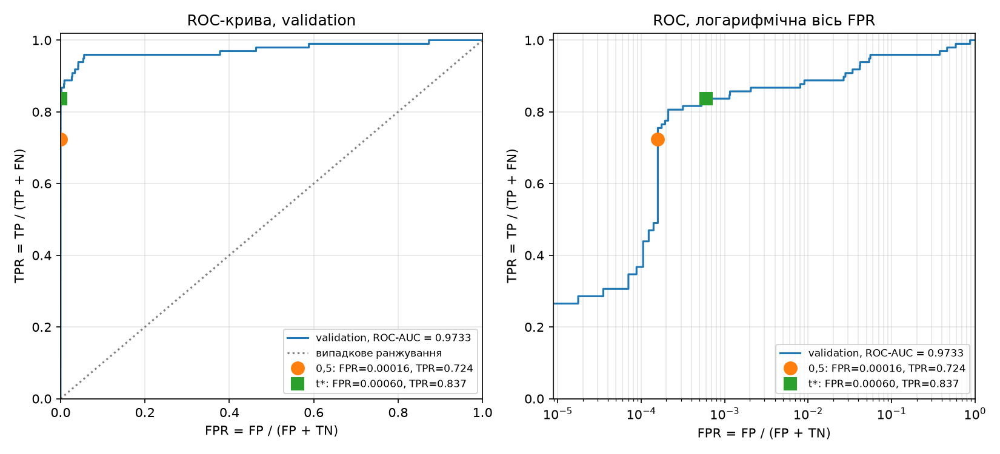
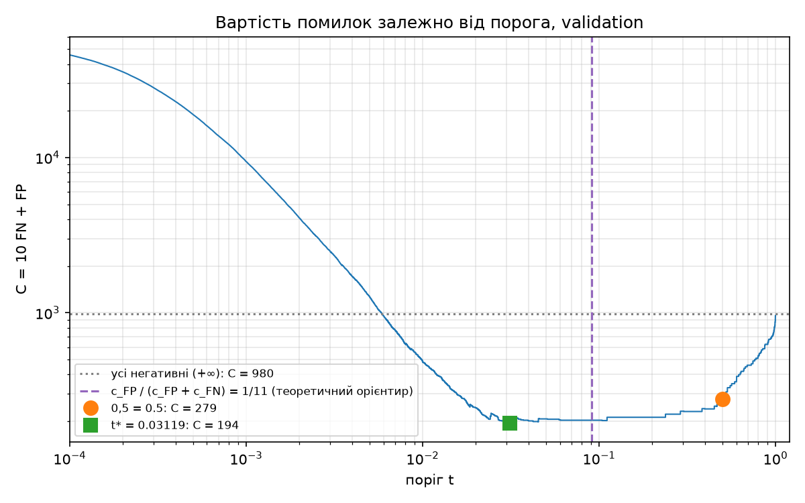

# ЛР2. Поріг рішення під асиметричну ціну помилок

Модель $\mathrm{Linear}(29,32) \to \mathrm{ReLU} \to \mathrm{Linear}(32,1)$ навчена один раз на наборі Credit Card Fraud Detection. Далі змінюється лише поріг рішення $t$: його обрано на validation за мінімумом вартості помилок $C(t) = 10\,FN(t) + FP(t)$, перевірено на трьох малих наборах і один раз застосовано до test.

## 1. Відтворення

Python 3.12; версії залежностей зафіксовано в `pyproject.toml` та `uv.lock`.

Набір даних: [Kaggle, mlg-ulb/creditcardfraud](https://www.kaggle.com/datasets/mlg-ulb/creditcardfraud), файл `creditcard.csv` (для завантаження потрібен обліковий запис Kaggle). До репозиторію файл не додано; шлях до нього передається параметром `--data`.

```bash
cd lab2
uv sync --locked
uv run python analysis.py
uv run python lab2_starter.py --data /шлях/до/creditcard.csv --out results_rerun
```

| Команда | Що робить |
| :-- | :-- |
| `analysis.py` | аналіз зі збережених прогнозів у `results/`, без навчання і без CSV: перевірки, вибір порога, тест; результати в `outputs/` |
| `lab2_starter.py --data … --out …` | навчання з локального CSV (стартовий код, без змін) |

Тека для `--out` має бути порожньою або новою: стартовий код не перезаписує наявних результатів, тому для повторного навчання використано `results_rerun`, а не `results`. Повторне навчання дає той самий поділ і ті самі статистики стандартизації; оцінки $s_i$ на іншій платформі чи версії PyTorch можуть відрізнятися в молодших розрядах. Усі числа в цьому звіті отримано зі збережених прогнозів у `results/`, тому `analysis.py` відтворює їх точно.

| Файл | Призначення |
| :-- | :-- |
| `lab2_starter.py` | стартовий код: поділ, стандартизація, навчання, збереження прогнозів |
| `thresholds.py` | підрахунок $TP, FP, FN, TN$ і $C$ за порогом; пошук порога через сортування й кумулятивні суми |
| `checks.py` | незалежна перевірка пошуку повільним перебором на наборах A, B, C |
| `analysis.py` | криві, таблиця кандидатів, $t^*$, перевірки, тест, таблиця помилок |
| `results/` | ваги `model.pt`, індекси поділу, мітки, сирий Amount і оцінки (`predictions.npz`), статистики стандартизації, лог навчання |
| `outputs/` | криві, `candidates_validation.csv`, `threshold.json` ($t^*$), `checks.md`, `test.md`, `errors_test.csv` |

`candidates_validation.csv` містить пороги без округлення. Щоб pandas прочитав їх точно, потрібен `pd.read_csv(..., float_precision="round_trip")`.

## 2. Дані, поділ і навчання

**Дані.** 284 807 транзакцій, із них 492 шахрайські. Ціль `Class`: 1 означає шахрайство, 0 — легітимну транзакцію. На вхід моделі подаються 29 ознак: V1–V28 і Amount. `Time` і `Class` не використовуються. Сире значення Amount збережено окремо для аналізу помилок.

**Поділ 60/20/20, стратифікований.** Рядки CSV зберігають початковий порядок; ділимо їхні індекси $0, \dots, 284\,806$:

1. `train_test_split(idx, test_size=0.4, stratify=Class, random_state=0)` — 60 % у train, 40 % відкладено.
2. Відкладені індекси ділимо навпіл: `train_test_split(..., test_size=0.5, stratify=мітки відкладених, random_state=0)`. Перша частина — validation, друга — test.

| Вибірка | Об'єктів | Шахрайських | Частка шахрайських |
| :-- | --: | --: | --: |
| train | 170 884 | 295 | 0,1726 % |
| validation | 56 961 | 98 | 0,1720 % |
| test | 56 962 | 99 | 0,1738 % |

Стратифікація дає майже однакову частку шахрайства в усіх трьох вибірках. Без неї за 0,17 % позитивів у validation чи test могло б потрапити помітно більше або менше шахрайських транзакцій.

**Стандартизація.** `StandardScaler` навчено лише на train: для кожної ознаки $x' = (x - \mu_{train}) / \sigma_{train}$. До validation і test застосовано ті самі $\mu_{train}$, $\sigma_{train}$. Масиви для моделі перетворено на `float32`. Класи не балансуються.

*Чому статистики не можна рахувати на всьому наборі.* Тоді середні й дисперсії містили б інформацію з validation і test, тобто дані, які мають бути «новими» для моделі, вплинули б на передобробку. Це витік даних: validation і test перестають бути незалежними від навчання, і оцінка на них стає оптимістичною. Крім того, для реальної нової транзакції ми знаємо лише статистики, відомі на момент навчання, тож і оцінювати модель слід у тих самих умовах.

**Навчання** (налаштування фіксовані, нічого не підбиралося):

| Налаштування | Значення |
| :-- | :-- |
| Модель | `Linear(29,32) → ReLU → Linear(32,1)`, стандартна ініціалізація `nn.Linear` після `torch.manual_seed(0)` |
| Функція втрат | `BCEWithLogitsLoss`, середнє за пакетом, без зважування класів |
| Оптимізатор | Adam, швидкість навчання $10^{-3}$, решта параметрів за замовчуванням |
| Навчання | 12 епох, пакет 1024, останній неповний пакет не відкидається; перемішування train — окремий `np.random.default_rng(0)`, нова перестановка на кожній епосі |
| Обчислення | CPU, `float32` |

`BCEWithLogitsLoss` отримує логіт $z_i$, а не ймовірність: сигмоїда вже входить у функцію втрат. Втрата за пакетом $B$:

$$L = -\frac{1}{|B|}\sum_{i\in B}\Big[y_i \log \sigma(z_i) + (1-y_i)\log\big(1-\sigma(z_i)\big)\Big], \qquad \sigma(z) = \frac{1}{1+e^{-z}}.$$

Втрата на train за епохами знизилася з 0,3653 до 0,00338 (`results/train_log.txt`). Використано ваги після 12-ї епохи; епоху за validation не обирали.

Після навчання модель переведено в `eval()` і без обчислення градієнтів отримано оцінки $s_i = \sigma(z_i)$ для validation і test. Їх збережено без округлення разом з індексами поділу, мітками й сирим Amount. Решта роботи використовує лише ці збережені прогнози.

## 3. Позначення і формули

Позитивний клас — шахрайство. Для порога $t$ рішення таке:

$$\hat y_i = 1[s_i \ge t].$$

Матриця плутанини:

- $TP$ — істинно позитивні: шахрайські транзакції, які модель виявила;
- $FP$ — хибно позитивні (хибна тривога): легітимні транзакції, позначені як шахрайські;
- $FN$ — хибно негативні: пропущене шахрайство;
- $TN$ — істинно негативні: легітимні транзакції, правильно віднесені до негативного класу.

Вартість помилок (Amount у формулу не входить; коефіцієнти навчальні):

$$C(t) = 10\,FN(t) + FP(t).$$

Метрики (точність — precision, повнота — recall):

$$\mathrm{precision} = \frac{TP}{TP + FP}, \qquad \mathrm{recall} = \mathrm{TPR} = \frac{TP}{TP + FN}, \qquad \mathrm{FPR} = \frac{FP}{FP + TN}.$$

Якщо знаменник дорівнює нулю, метрика не визначена: $TP + FP = 0$ означає, що не зроблено жодного позитивного рішення; $TP + FN = 0$ — що у вибірці немає шахрайських транзакцій.

## 4. Вибір порога на validation

У validation $n = 56\,961$ об'єкт: $P = 98$ шахрайських, $N = 56\,863$ легітимних, частка позитивів $\pi = 0{,}00172$.

### 4.1. Криві PR і ROC

Криві побудовано функціями scikit-learn (`precision_recall_curve`, `roc_curve`, `roc_auc_score`).





**ROC-AUC = 0,9733**, середня точність AP = 0,7847.

*Чому висока ROC-AUC не гарантує малої вартості помилок чи високої точності.*

1. ROC-AUC підсумовує якість ранжування за **всіма** порогами, а рішення приймається за **одним**. Вартість залежить від конкретної робочої точки й від цін помилок, про які ROC-AUC нічого не знає.
2. У $\mathrm{FPR}$ знаменник — усі 56 863 легітимні транзакції, тому навіть сотні хибних тривог дають малу FPR. У точності знаменник — лише позитивні рішення. Ці величини пов'язані формулою:
   $$\mathrm{precision} = \frac{\pi\,\mathrm{TPR}}{\pi\,\mathrm{TPR} + (1-\pi)\,\mathrm{FPR}}.$$
   За $\pi = 0{,}00172$ друга складова знаменника легко переважає першу. Приклад із нашої кривої: за $\mathrm{FPR} \approx 1\,\%$ модель виявляє 87 з 98 шахрайств, але дає 569 хибних тривог. Точність тоді 0,133, а $C = 679$, хоча на ROC-кривій ця точка виглядає «майже ідеально».
3. Робоча зона цієї задачі — $\mathrm{FPR} < 0{,}001$ (права частина ROC-рисунка, логарифмічна вісь). Площа ROC-AUC здебільшого набирається за значно більших FPR, тому про цю зону вона майже нічого не каже.

Так само частка правильних відповідей тут неінформативна: класифікатор «усі негативні» має її 0,99828, але $C = 980$.

### 4.2. Пошук порога

**Кандидати** — усі унікальні оцінки validation (55 988 значень) і $+\infty$, разом 55 989. Поріг $+\infty$ означає «усі негативні», найменша оцінка ($s = 0$: сигмоїда у `float32` зникає до нуля) — «усі позитивні». Рівних оцінок багато: 717 груп, у яких разом 1 690 прикладів, найбільша група — 16 прикладів. Тому обробка рівних оцінок тут важлива не лише в теорії.

**Алгоритм** (`thresholds.threshold_table`), складність $O(n \log n)$:

1. Сортуємо приклади за спаданням $s$ — $O(n \log n)$.
2. Рахуємо кумулятивні суми позитивних і негативних міток за відсортованим порядком — $O(n)$. Сума до позиції $k$ включно — це кількість позитивів (негативів) серед $k+1$ прикладів з найбільшими оцінками.
3. Для кожної унікальної оцінки $u$ беремо значення кумулятивних сум у **кінці групи** рівних оцінок $u$. За правилом $s_i \ge u$ позитивними є саме всі приклади до кінця цієї групи, тому $TP(u)$ і $FP(u)$ — це ці дві суми. **Рівні оцінки отримують однаковий прогноз:** групу неможливо «розрізати» порогом.
4. Додаємо рядок $t = +\infty$ з $TP = FP = 0$. Далі $FN = P - TP$, $TN = N - FP$, $C = 10\,FN + FP$.

Повторного проходу по вибірці для кожного порога немає: після сортування вся таблиця виходить за один прохід.

**Вибір $t^*$** (`thresholds.select_threshold`): мінімум $C$; якщо мінімум досягається на кількох порогах, обираємо **найбільший** з них. Таблиця впорядкована за спаданням порога ($+\infty$ першим), тому перше входження мінімуму і є найбільшим порогом.

Повна таблиця кандидатів (поріг, $TP, FP, FN, TN, C$) — `outputs/candidates_validation.csv`; зафіксований поріг — `outputs/threshold.json`.

### 4.3. Результат на validation

| Правило на validation | Поріг | TP | FP | FN | TN | C |
| :-- | --: | --: | --: | --: | --: | --: |
| Стандартний поріг | 0,5 | 71 | 9 | 27 | 56 854 | 279 |
| Мінімум вартості | $t^*$ = 0,0311939 | 82 | 34 | 16 | 56 829 | 194 |
| Усі негативні | $+\infty$ | 0 | 0 | 98 | 56 863 | 980 |

| Правило на validation | Точність | Повнота | FPR |
| :-- | --: | --: | --: |
| Стандартний поріг | 0,8875 | 0,7245 | 0,00016 |
| Мінімум вартості | 0,7069 | 0,8367 | 0,00060 |
| Усі негативні | не визначена (0/0) | 0 | 0 |

Точне значення $t^* = 0{,}031193923205137253$; округлення лише для відображення. Мінімум $C = 194$ досягається на одному порозі.



На скінченній вибірці $C(t)$ кусково-стала: вона змінюється лише тоді, коли поріг перетинає оцінку якогось приклада. Мінімум вузький: $t^*$ точно дорівнює оцінці одного шахрайського приклада. Уже за наступним більшим кандидатом (0,031203) цей приклад стає $FN$, і $C = 204$.

Поріг 0,5 оптимальний лише тоді, коли $s_i$ — правильна умовна ймовірність $\Pr(y = 1 \mid x)$, ціни двох типів помилок однакові, а правильні рішення нічого не коштують. Тут пропуск коштує вдесятеро більше за хибну тривогу. Позитивне рішення в середньому коштує $c_{FP}(1 - s)$, негативне — $c_{FN}\,s$; позитив вигідніший, коли $c_{FP}(1 - s) \le c_{FN}\,s$, звідки теоретичний поріг:

$$\tau^* = \frac{c_{FP}}{c_{FP} + c_{FN}} = \frac{1}{1+10} = \frac{1}{11} \approx 0{,}091.$$

На validation він дав би $C = 203$. Розбіжність між $t^* = 0{,}031$ і $1/11$ **не є мірою некаліброваності**: на неї впливають скінченна вибірка (лише 98 позитивів), неєдиність і вузькість мінімуму, спосіб пошуку і лише потім можливе некалібрування оцінок. Формула $1/11$ — теоретичний орієнтир, а поріг обрано емпірично за всіма кандидатами.

## 5. Перевірка пошуку порога на малих наборах

Перевірочна реалізація (`checks.py`) написана окремо, на звичайному Python, і не використовує швидкий алгоритм чи його результати:

- власний список кандидатів — $+\infty$ і всі унікальні оцінки, той самий, що й на validation (розділ 4.2);
- для кожного кандидата правило $s_i \ge t$ застосовано прямо до кожного приклада;
- власний вибір порога: мінімум $C$, за нічиєї — найбільший поріг.

Потім обидві реалізації порівнюються точно, без допусків. На всіх трьох наборах **збіглися всі пороги, лічильники $TP, FP, FN, TN$, вартості $C$ і обраний $t^*$**. Нижче наведено таблиці перебору; повні таблиці порівняння — `outputs/checks.md`. Лише після цих перевірок `analysis.py` фіксує $t^*$ і переходить до test.

**Набір A:** $s = [0{,}9;\ 0{,}7;\ 0{,}7;\ 0{,}4;\ 0{,}2;\ 0{,}1]$, $y = [0;\ 1;\ 0;\ 1;\ 0;\ 0]$.

| Поріг | TP | FP | FN | TN | C |
| :-- | --: | --: | --: | --: | --: |
| $+\infty$ | 0 | 0 | 2 | 4 | 20 |
| 0,9 | 0 | 1 | 2 | 3 | 21 |
| 0,7 | 1 | 2 | 1 | 2 | 12 |
| **0,4** | **2** | **2** | **0** | **2** | **2** |
| 0,2 | 2 | 3 | 0 | 1 | 3 |
| 0,1 | 2 | 4 | 0 | 0 | 4 |

$t^* = 0{,}4$, $C = 2$.

*Що перевіряють рівні оцінки.* Дві оцінки 0,7 мають різні мітки (1 і 0). За $t = 0{,}7$ обидва приклади мають стати позитивними разом: $TP = 1$, $FP = 2$ (разом з 0,9). Якби реалізація обробляла приклади поодинці, з'явився б неможливий стан «лише один із двох прикладів з оцінкою 0,7 позитивний» ($TP = 1$, $FP = 1$). Також не можна рахувати 0,7 двома кандидатами.

**Набір B:** $s = [0{,}9;\ 0{,}6;\ 0{,}3]$, $y = [0;\ 0;\ 0]$.

| Поріг | TP | FP | FN | TN | C |
| :-- | --: | --: | --: | --: | --: |
| $+\infty$ | **0** | **0** | **0** | **3** | **0** |
| 0,9 | 0 | 1 | 0 | 2 | 1 |
| 0,6 | 0 | 2 | 0 | 1 | 2 |
| 0,3 | 0 | 3 | 0 | 0 | 3 |

$t^* = +\infty$, $C = 0$.

*Що перевіряє відсутність позитивних міток.* Коли $P = 0$, будь-який скінченний поріг дає лише хибні тривоги, тому мінімум досягається на крайньому кандидаті $+\infty$ («усі негативні»). Якщо $+\infty$ немає серед кандидатів, правильну відповідь отримати неможливо. Крім того, за $t^*$ точність і повнота не визначені (0/0), і код не повинен на цьому падати діленням на нуль.

**Набір C:** $s = [0{,}8;\ \underbrace{0{,}5;\ \dots;\ 0{,}5}_{11};\ 0{,}2]$, $y = [1;\ 1;\ \underbrace{0;\ \dots;\ 0}_{10};\ 0]$ — перша з одинадцяти оцінок 0,5 має мітку 1, решта десять — 0.

| Поріг | TP | FP | FN | TN | C |
| :-- | --: | --: | --: | --: | --: |
| $+\infty$ | 0 | 0 | 2 | 11 | 20 |
| **0,8** | **1** | **0** | **1** | **11** | **10** |
| 0,5 | 2 | 10 | 0 | 1 | 10 |
| 0,2 | 2 | 11 | 0 | 0 | 11 |

$t^* = 0{,}8$, $C = 10$.

*Що перевіряють два кандидати з однаковою вартістю.* Пороги 0,8 (один пропуск: $10 \cdot 1$) і 0,5 (десять хибних тривог: $10 \cdot 1$) мають однакову $C = 10$. Правило розв'язання нічиєї вимагає обрати найбільший поріг, 0,8. Реалізація, яка бере останній мінімум, обрала б 0,5. Одинадцять рівних оцінок 0,5 з різними мітками заодно ще раз перевіряють групування.

Окремо ми переконалися, що перевірка справді ловить помилки. Для цього в швидкий пошук навмисно вносили типові помилки: без групування рівних оцінок, без кандидата $+\infty$, правило $s_i > t$ замість $s_i \ge t$, вибір найменшого порога за нічиєї. Кожну з них виявив щонайменше один набір: групування — A і C, $+\infty$ — B, нічию — C.

## 6. Тестова оцінка та аналіз помилок

Поріг $t^* = 0{,}0311939$, зафіксований на validation, застосовано до test **один раз**; інших порогів на test не рахували. Результати test не використовувалися для зміни порога, моделі чи налаштувань навчання. У test $n = 56\,962$: $P = 99$, $N = 56\,863$.

| | Прогноз 1 (шахрайство) | Прогноз 0 (легітимна) |
| :-- | --: | --: |
| Справжній клас 1 | $TP = 80$ | $FN = 19$ |
| Справжній клас 0 | $FP = 43$ | $TN = 56\,820$ |

- $C = 10 \cdot 19 + 43 = 233$;
- точність $= 80 / (80 + 43) = 0{,}6504$;
- повнота $= 80 / (80 + 19) = 0{,}8081$.

Обидва знаменники ненульові, тож метрики визначені.

Перші п'ять хибнопозитивних і перші п'ять хибнонегативних прикладів за номером рядка CSV (усього на test $FP = 43$, $FN = 19$). Остання колонка — відстань оцінки від порога. Точні значення — `outputs/errors_test.csv`.

| Рядок CSV (від 0, без заголовка) | Тип помилки | Мітка | Оцінка $s$ | Amount | $s - t^*$ |
| --: | :-- | --: | --: | --: | --: |
| 460 | FP | 0 | 0,196159 | 2,00 | +0,164965 |
| 2961 | FP | 0 | 0,0809608 | 2,49 | +0,0497669 |
| 10783 | FP | 0 | 0,966327 | 89,99 | +0,935133 |
| 13405 | FP | 0 | 0,932032 | 89,99 | +0,900838 |
| 13617 | FP | 0 | 0,922762 | 89,99 | +0,891568 |
| 10497 | FN | 1 | 0,0114644 | 3,79 | −0,0197296 |
| 52521 | FN | 1 | 0,00637312 | 105,99 | −0,0248208 |
| 55401 | FN | 1 | 0,00564156 | 1,00 | −0,0255524 |
| 91671 | FN | 1 | 0,000500424 | 290,18 | −0,0306935 |
| 93486 | FN | 1 | 0,0183515 | 0,00 | −0,0128424 |

**Сирі Amount.** Суми в обох групах дуже різні й перекриваються: у FP від 2,00 до 89,99, у FN від 0,00 до 290,18. Три FP мають однакову суму 89,99, але три приклади не є закономірністю. Простого правила на кшталт «помилки — це великі або малі суми» тут не видно.

**Відстань від порога.** Усі п'ять FN лежать трохи нижче порога ($s - t^*$ від −0,031 до −0,013): модель дала цим шахрайствам низькі оцінки, і нижчий поріг виявив би частину з них, але ціною нових хибних тривог. FP поводяться по-різному. Два (рядки 460 і 2961, $s$ = 0,196 і 0,081) лежать недалеко над порогом і стали позитивними саме через зниження порога з 0,5. Три з сумою 89,99 мають впевнені оцінки 0,92–0,97 і були б хибними тривогами за будь-якого розумного порога: тут помиляється сама модель, а не поріг.

**Чи можна за десятьма прикладами судити про причину помилок? Ні.**

- Це 10 з 62 помилок test, відібрані за номером рядка, а не випадково.
- Медіана Amount у цих п'яти FP дорівнює 89,99, а серед усіх 43 FP на test — 2,49: вибірка з десяти прикладів навіть за Amount не представляє всіх помилок.
- Ознаки V1–V28 анонімізовані (результат PCA), тому за ними не можна змістовно пояснити, що саме модель «побачила».

Такі приклади показують лише, як помилки розташовані відносно порога. Щоб говорити про причини, потрібен систематичний аналіз на більшій кількості помилок.

## 7. Висновки

**Що змінив вибір порога в роботі незмінної моделі.** Ваги й оцінки $s_i$ ті самі; змінилося лише правило рішення: поріг знижено з 0,5 до $t^* = 0{,}0312$. На validation це змінило рішення для 36 транзакцій з оцінками $0{,}0312 \le s_i < 0{,}5$: тепер вони позначаються як шахрайські. Серед них 11 справді шахрайські й 25 легітимні. Вартість помилок зменшилася з 279 до 194 (на 30 %), повнота зросла з 0,7245 до 0,8367, точність знизилася з 0,8875 до 0,7069. Отже, стандартний поріг 0,5 не підходить, коли пропуск у 10 разів дорожчий за хибну тривогу.

**Ціна рішення в термінах $FP$ і $FN$.** Ціною 25 додаткових хибних тривог ($FP$: 9 → 34) модель знайшла 11 шахрайств, які раніше пропускала ($FN$: 27 → 16). Це приблизно 2,3 хибні тривоги на одне додатково виявлене шахрайство. За заданих цін вигідно: $10 \cdot 11 = 110 > 25$.

**Чому результат на validation не гарантує такого самого виграшу на test.**

1. $t^*$ обрано на validation як найкращий із 55 989 кандидатів; через це значення $C = 194$ — оптимістична оцінка саме для цієї вибірки.
2. Позитивів мало (98 і 99), а кожен $FN$ коштує 10, тож кілька інших прикладів помітно змінюють $C$.
3. Мінімум вузький: $t^*$ дорівнює оцінці одного шахрайського приклада, і вже на сусідньому кандидаті $C = 204$.

На test той самий $t^*$ дав $C = 233$ ($FN = 19$, $FP = 43$) проти 194 на validation. Порівнювати пороги за тестом і переобирати поріг не можна: тоді тестова оцінка перестала б бути незалежною й стала б так само оптимістично зміщеною, як і вибір гіперпараметрів за тестом.

## 8. Джерела

- Стартовий код `lab2_starter.py`.
- Лекції та методичні матеріали з дисципліни.
- Генеративні інструменти: під час написання коду, перевірок і цього звіту використано Claude.
