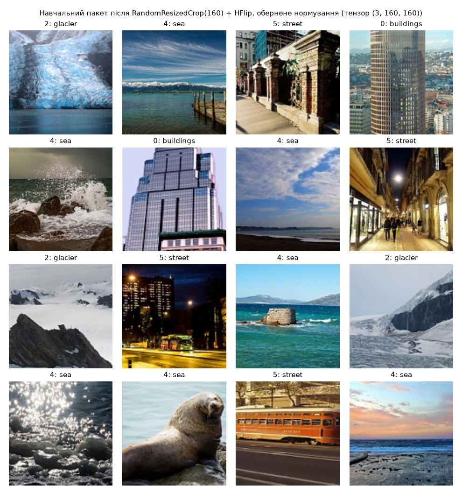
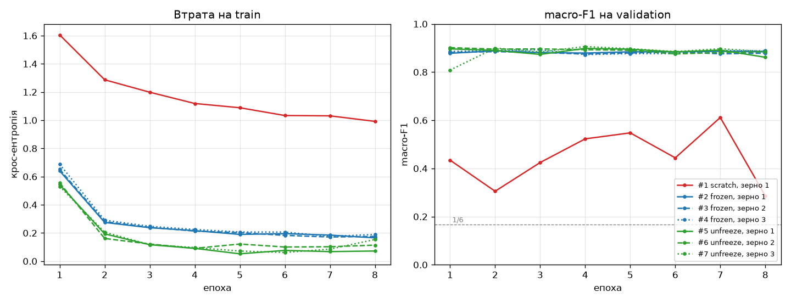
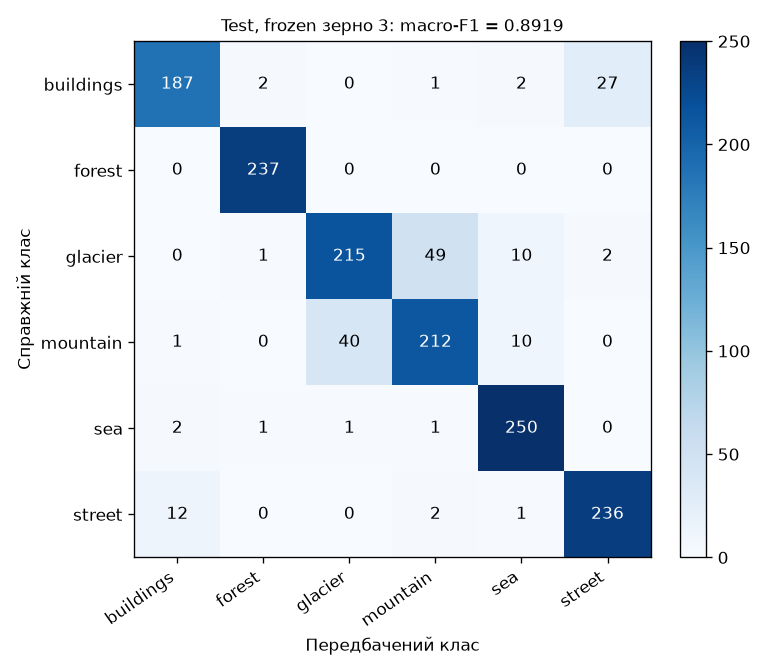
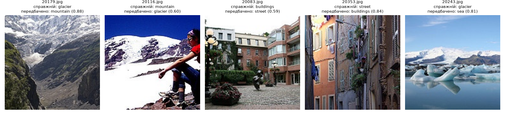

# ЛР3. Обчислювальний експеримент і трансферне навчання

**Мета.** Порівняти три режими навчання ResNet-18 на малій вибірці (200 зображень на клас) за однакового обчислювального бюджету й з'ясувати три речі:

- яку частину виграшу дають попередньо навчені ознаки;
- яку частину дає донавчання кістяка;
- чи більша кожна з цих різниць за розкид між зернами.

**Відповідь** (подробиці в розділах 8–10):

| Ефект | Значення | Порівняння з порогом шуму $R = 2{,}40$ п. | Висновок |
| :-- | --: | :-- | :-- |
| попереднього навчання | $\Delta_\text{pre} = +59{,}81$ п. macro-F1 | $\lvert\Delta\rvert > R$ | ефект вартий перевірки |
| розморожування | $\Delta_\text{unf} = -0{,}65$ п. | $\lvert\Delta\rvert \le R$ | різниця не відрізняється від розкиду, результату немає |

Вибрана модель (frozen, зерно 3) дає на test macro-F1 = 0,8919.

## 1. Відтворення

Python 3.12. Залежності зафіксовано в `pyproject.toml` і `uv.lock`: torch 2.14.1, torchvision 0.29.2, numpy 2.5.5, scikit-learn 1.9.1, matplotlib 3.11.2, pillow 13.0.0.

Набір: [Kaggle, puneet6060/intel-image-classification](https://www.kaggle.com/datasets/puneet6060/intel-image-classification). Шлях до розпакованого архіву (теки `seg_train/` і `seg_test/`) передається параметром `--data`. До репозиторію набір не додано. Ваги ImageNet для ResNet-18 torchvision при першому запуску завантажує сама, з `download.pytorch.org`.

```bash
cd lab3
uv sync --locked
uv run python analysis.py --data /шлях/до/intel-image-classification
uv run python train.py --data /шлях/до/intel-image-classification --out rerun
uv run python analysis.py --data /шлях/до/intel-image-classification --out rerun
```

Що робить кожна команда:

1. `analysis.py` без `--out` працює на збережених у репозиторії журналах і `lab3_model.pt` та відтворює всі числа цього README.
2. `train.py --out rerun` — повне навчання в окрему теку, щоб не перезаписати збережені результати. Без `--out` результати пишуться в теку коду.
3. `analysis.py --out rerun` — аналіз нових запусків.

`--device` (`auto`, `cpu`, `mps`, `cuda`; за замовчуванням `auto`) вибирає пристрій навчання. Test завжди обчислюється на CPU.

| Команда | Що робить | test |
| :-- | :-- | :-- |
| `train.py` | поділ → перевірки до навчання → сім запусків → журнали → вибір за validation → `lab3_model.pt` (≈ 3 хв на MPS, на CPU довше) | не завантажується |
| `analysis.py` | перевірка хешу `split.csv` у журналах → таблиця, криві, ефекти, перевірка вибору (лише з журналів) → один раз на CPU: test, матриця плутанини, п'ять помилок | лише тут |

Розподіл коду за файлами:

| Файл | Вміст |
| :-- | :-- |
| `common.py` | класи, нормування, бюджет, список семи запусків, правило вибору, тека результатів, SHA-256, git, версії |
| `data.py` | поділ, контрольна таблиця, перетворення, набір даних, завантажувачі; `load_test_set` викликається лише з `analysis.py` |
| `model.py` | таблиця режимів, побудова моделі (кроки 1–5), `set_train_mode`, AdamW, цикл навчання, macro-F1 |
| `checks.py` | перевірки до навчання, перевірка режимів і дослід з навмисною помилкою |

Результати:

| Шлях | Вміст |
| :-- | :-- |
| `split.csv` | поділ: `file`, `label`, `part` |
| `runs/<режим>_seed<зерно>/` | `run.json` (журнал запуску) і `val_logits.npy` (1498×6, порядок рядків validation у `split.csv`) |
| `lab3_model.pt` | ваги вибраного запуску: `state_dict`, `regime`, `seed`, `classes`, `img_size` = 160 |
| `outputs/` | `checks.md` (перевірки), `analysis.md` (усі числа розділів 8–10), `errors_test.csv`, `test_logits.npy`, логи обох команд |
| `figures/` | `batch.png`, `curves.png`, `confusion_matrix.png`, `errors.png` |

**Що відтворюється.**

- Повторне навчання дає той самий поділ (таблиця контролю), ту саму конфігурацію й ті самі відповіді «так/ні» в перевірках режимів.
- macro-F1 на іншій машині може відрізнятися: обчислення на GPU і MPS недетерміновані й залежать від версій бібліотек.
- Перевірено на чистій копії репозиторію (лише файли, що входять у git, нове середовище `uv sync --locked`):
  - `analysis.py` дав `outputs/analysis.md`, що збігся з цим README;
  - `train.py --out rerun` на тій самій машині відтворив поділ, усі перевірки, усі сім значень $F_{r,s}$ і біт у біт ті самі ваги `lab3_model.pt`;
  - `analysis.py --out rerun` дав ті самі числа; відрізнявся лише час навчання (на 0,1–0,7 с).

**Версії коду.** Сім запусків зроблено з коміту `c7a1282` без незакомічених змін: у кожному `run.json` записано `"dirty": false`. Ознака dirty стосується лише файлів коду `lab3/`.

Після запусків у коді змінено лише оформлення й зручність запуску:

- сигнатура `set_train_mode(model, frozen_modules)`;
- підписи таблиць і коментарі;
- у перевірці режимів до ковзних статистик зараховано лише `running_mean` і `running_var`;
- параметр `--out` і перевірка шляху `--data`.

Що навчання від цього не змінилося, перевірено двічі:

- на CPU 1 епоха frozen і unfreeze зі старим і новим кодом дала біт у біт однакові ваги, втрату й macro-F1;
- повне повторне навчання фінальним кодом відтворило всі сім запусків (див. вище).

**Відхилень від фіксованих налаштувань немає.** Технічні подробиці:

- Зображення один раз відкриваються через Pillow з `.convert("RGB")` і тримаються в пам'яті. Випадкові перетворення застосовуються при кожному зверненні, тож результат той самий, що й при читанні з диска.
- Ключ `name` у групах AdamW — лише підпис.

**Пробний прогін.** Перед основним експериментом обидві команди один раз прогнано на окремій копії коду з 1 епохою, щоб перевірити, що конвеєр виконується до кінця. Ці числа ні на що не вплинули, бо всі налаштування фіксовані, і до звіту не входять.

## 2. Дані й поділ

Процедура:

1. Файли кожного класу впорядковуються як рядки (`sorted`, як у `ImageFolder`: `0.jpg, 10006.jpg, 1001.jpg, …`).
2. **train.** Один `rng = np.random.default_rng(0)` на всі класи по черзі в порядку `buildings, forest, glacier, mountain, sea, street`. `idx = np.arange(n_k)`, `rng.shuffle(idx)`, у train іде `idx[:200]`.
3. **validation і test.** **Новий** `default_rng(0)`, так само по класах `seg_test`, `cut = n_k // 2`: `idx[:cut]` іде у validation, `idx[cut:]` у test.

Далі всі дані завантажуються лише за `split.csv`.

**Контроль** — «кількість / сума числових імен файлів»:

| Клас | train | validation | test | Збіг |
| :-- | --: | --: | --: | :-: |
| buildings | 200 / 1 996 761 | 218 / 4 837 323 | 219 / 4 837 559 | так |
| forest | 200 / 2 032 625 | 237 / 5 276 962 | 237 / 5 291 326 | так |
| glacier | 200 / 2 183 923 | 276 / 6 135 652 | 277 / 6 157 250 | так |
| mountain | 200 / 1 950 345 | 262 / 5 789 535 | 263 / 5 849 765 | так |
| sea | 200 / 1 987 613 | 255 / 5 655 068 | 255 / 5 668 011 | так |
| street | 200 / 1 841 817 | 250 / 5 541 845 | 251 / 5 547 533 | так |
| Разом | 1200 / 11 993 084 | 1498 / 33 236 385 | 1502 / 33 351 444 | так |

- **Усі 18 клітинок збігаються.**
- Перетини частин порожні: train ∩ validation = 0, train ∩ test = 0, validation ∩ test = 0. Усі 4200 імен файлів унікальні.
- SHA-256 `split.csv` = `148dad92de9a18670c177df9f8757aa6519fb0ea6d74a8ba723cfc4453f0a1bc`. Це запис версії даних («Трекінг експериментів»).

## 3. Перетворення

| Частина | Перетворення |
| :-- | :-- |
| train | `RandomResizedCrop(160, scale=(0.7, 1.0))` → `RandomHorizontalFlip()` → `ToTensor()` → `Normalize(mean, std)` |
| validation, test | `Resize((160, 160))` → `ToTensor()` → `Normalize(mean, std)` |

$\text{mean} = (0{,}485;\ 0{,}456;\ 0{,}406)$, $\text{std} = (0{,}229;\ 0{,}224;\ 0{,}225)$ — статистики ImageNet. Решта параметрів за замовчуванням: `ratio=(3/4, 4/3)`, білінійна інтерполяція, `p=0.5`. Повний список записано в кожному `run.json`.

Чому так:

- **Аугментація лише в train.** Валідаційні перетворення детерміновані: одне зображення завжди дає той самий тензор.
- **Нормування ImageNet і в scratch.** Попередньо навчений перший шар очікує входи саме в такому масштабі. Ті самі числа в scratch потрібні, щоб режими відрізнялися лише ініціалізацією й тим, що навчається.
- **Розмір 160.** 160 = 5·32 кратне сумарному кроку мережі 32. Майже всі зображення мають розмір 150×150, 55 зображень менші за висотою; `Resize` і `RandomResizedCrop` вирівнюють розмір.

## 4. Модель і режими

ResNet-18 на вході 160×160:

- вхідний блок `conv1` (7×7, крок 2) + `bn1` + max-пулінг: 160 → 80 → 40;
- стадії `layer1`–`layer4`: 40 → 20 → 10 → 5;
- карта 512×5×5 → глобальний усереднювальний пулінг → вектор 512 → голова `fc`.

**Кістяк** — усе до `fc`; **голова** — `fc`.

Кожен запуск будує модель так (кроки 1–5; `model.build_model`):

1. `torch.manual_seed(seed)` і `np.random.seed(seed)`.
2. `resnet18(weights=W)`: `W = None` для scratch, `ResNet18_Weights.IMAGENET1K_V1` для frozen і unfreeze.
3. `model.fc = nn.Linear(512, 6)` зі стандартною ініціалізацією.
4. `requires_grad=False` для всіх параметрів, крім тих, що навчаються.
5. `.to(device)`, потім AdamW. В оптимізатор потрапляють лише параметри, що навчаються, і лише після заміни `fc`; інакше нова голова в оптимізатор не потрапила б (крок 3 протоколу налагодження).

| Режим | Ваги | Що навчається | Параметрів, що навчаються | Групи AdamW: параметри, швидкість навчання | У `eval()` під час навчання |
| :-- | :-- | :-- | --: | :-- | :-- |
| scratch | випадкові | уся мережа | 11 179 590 | усі, $3\cdot10^{-3}$ | — |
| frozen | ImageNet | `fc` | 3 078 | `fc`, $3\cdot10^{-3}$ | `conv1`, `bn1`, `layer1`–`layer4` |
| unfreeze | ImageNet | `layer4`, `fc` | 8 396 806 | `fc`, $3\cdot10^{-3}$; `layer4`, $3\cdot10^{-4}$ | `conv1`, `bn1`, `layer1`–`layer3` |

Загальні налаштування:

- AdamW з `weight_decay=1e-4` (спад ваг) в усіх групах, решта аргументів за замовчуванням. Спад ваг у AdamW відокремлений від адаптивного ділення.
- BN: `momentum=0.1`, `eps=1e-5`.
- Не використовуються: розклади швидкості навчання, обрізання градієнта, змішана точність, згладжування міток, зважування класів, рання зупинка, вибір епохи чи контрольної точки за validation.

Звідки числа параметрів:

- $3\,078 = 512\cdot6 + 6$.
- Стадія з $C$ каналами має $32C^2 + 10C$ параметрів. Для `layer4` ($C = 512$) це 8 393 728, з урахуванням проєкційного шорткату `downsample`.
- Отже, unfreeze навчає $8\,393\,728 + 3\,078 = 8\,396\,806$ параметрів.
- Загалом $11\,689\,512 - 513\,000 + 3\,078 = 11\,179\,590$: стара голова на 1000 класів замінена новою на 6.

**`set_train_mode`** («Пастка з пакетною нормалізацією»):

```python
def set_train_mode(model, frozen_modules):
    model.train()
    for m in frozen_modules:
        m.eval()   # BN у замороженій частині користується статистиками ImageNet
```

Функція викликається на початку кожної епохи замість голого `model.train()`. `frozen_modules` — модулі зі стовпця «У eval()».

> **Чому заморожені модулі мають бути в `eval()`.** `requires_grad=False` зупиняє градієнт, але не пакетну нормалізацію. У `train()` кожен шар BN за кожним пакетом оновлює ковзні статистики `running_mean` і `running_var`: $\hat\mu \leftarrow (1-0{,}1)\,\hat\mu + 0{,}1\,\mu_\text{пакета}$. Це буфери, а не параметри, і оптимізатор до них відношення не має. Без `eval()` статистики ImageNet поступово замінюються статистиками 1200 цільових зображень: ваги згорток ті самі, а ознаки інші. Тобто кістяк формально заморожено, але фактично він змінюється. Дослід у п. 6.3 це показує.

> **Навіщо кістяку менша швидкість навчання, ніж голові.** Нова голова випадкова, тож на старті втрата й градієнт великі. Градієнт іде назад у стадію 4 і зсуває попередньо навчені ваги ще до того, як голова стала осмисленою. На малій вибірці втрачене не повернути. Тому розморожують лише стадію 4 і дають їй у 10 разів меншу швидкість навчання: це дискримінативні швидкості навчання.

## 5. Цикл навчання

- **Завантажувачі.** train: `batch_size=32, shuffle=True, drop_last=False, num_workers=0`, без власного `generator` чи `sampler`. Перемішування й випадкові аугментації беруть випадковість із глобального генератора PyTorch, засіяного на кроці 1. validation: `batch_size=64, shuffle=False`, порядок як у `split.csv`.
- **Бюджет.** 8 епох по $\lceil 1200/32\rceil = 38$ кроків, разом **304 кроки** оптимізатора; у коді це перевіряє `assert`. Останній пакет епохи має 16 зображень.
- **Епоха.** `set_train_mode` → для кожного пакета: `zero_grad()`, прямий прохід, `CrossEntropyLoss()` (середнє за пакетом, на логітах, без softmax перед нею), `backward()`, `step()`.
- **Втрата епохи.** $\sum_b L_b\,|b| / 1200$, де $L_b$ — втрата пакета $b$ до кроку оптимізатора.
- **Після кожної епохи.** `model.eval()`, `torch.no_grad()`, логіти validation і macro-F1:

$$\mathrm{F1}_k = \frac{2TP_k}{2TP_k + FP_k + FN_k},\qquad \text{macro-F1} = \frac16\sum_{k=0}^{5}\mathrm{F1}_k$$

$TP_k$, $FP_k$, $FN_k$ рахуються для класу $k$ проти решти; у коді це `sklearn.metrics.f1_score(average="macro")`. Macro-усереднення дає кожному класу однакову вагу.

- **Підсумок запуску.** $F_{r,s}$ — macro-F1 на validation після 8-ї епохи для режиму $r$ і зерна $s$; використовуються ваги після 8-ї епохи.
- **Час навчання.** Час кроків оптимізатора із синхронізацією пристрою, без валідації. Час разом з валідацією записано окремо.

## 6. Перевірки до навчання

Повний вивід: `outputs/checks.md`.

### 6.1. Пакет після перетворень



Перші 16 зображень першого навчального пакета так, як їх отримує модель: після аугментацій, з оберненим нормуванням і міткою над кожним (крок 1 протоколу налагодження).

- Форма пакета 32×3×160×160.
- Мітки відповідають сценам.
- Кольори природні, отже канали не переставлено, а нормування обернено правильно.

### 6.2. Початкова втрата $L_0$

Для scratch і frozen: модель за кроками 1–5 зі зерном 1, `set_train_mode`, `torch.no_grad()`, втрата на першому пакеті до жодного кроку оптимізатора. Порівнюється з $\ln 6 = 1{,}7918$ — втратою моделі, що дає всім класам однакову ймовірність $1/6$ (крок 2 протоколу налагодження).

| Режим | $L_0$ | $L_0 - \ln 6$ | Норма ознак після глобального пулінгу | Стандартне відхилення логітів у прикладі $\sigma$ | Оцінка $\ln 6 + \tfrac12\cdot\tfrac56\sigma^2$ | Довідково: середня втрата за 38 пакетами без кроків |
| :-- | --: | --: | --: | --: | --: | --: |
| scratch | 2,0479 | +0,256 | 18,87 | 0,530 | 1,909 | 1,956 |
| frozen | 1,9244 | +0,133 | 28,02 | 0,649 | 1,967 | 1,984 |

**Пояснення відхилення.**

- $\ln 6$ точне лише для **однакових** логітів. Стандартна ініціалізація голови в PyTorch, $U(-1/\sqrt{512},\,1/\sqrt{512})$, дає не зовсім нульові логіти, тому старт трохи вищий за $\ln C$.
- Розкид логітів, не пов'язаний з міткою, у середньому збільшує втрату: $L = \operatorname{LSE}(z) - z_c$ (log-sum-exp), а LSE — опукла функція. Розклад до другого порядку дає оцінку $\ln 6 + \tfrac12\cdot\tfrac56\sigma^2$, тобто 1,91 і 1,97. Це узгоджується із середнім за всіма пакетами (1,96 і 1,98).
- Решта відхилення — шум одного пакета з 32 прикладів.
- У frozen розкид більший, бо ознаки ImageNet мають більшу норму (28 проти 19).
- Відхилення в межах +7…+14 %, а не «в кілька разів», тобто масштаб ініціалізації й нормування входу правильні. Відхилення вниз (ознаки витоку мітки) немає.

### 6.3. Перевірка режимів навчання

Кожна перевірка починається з нового екземпляра моделі (кроки 1–5, зерно 1). Ці 5-крокові моделі не оцінюються й не зберігаються.

**Параметри** (кількість — це сума `numel()`):

| Режим | Усього | `requires_grad=True` | Групи AdamW: параметрів, швидкість навчання | Параметрів з `requires_grad=False` в оптимізаторі | Збіг з таблицею режимів |
| :-- | --: | --: | :-- | --: | :-: |
| scratch | 11 179 590 | 11 179 590 | 11 179 590, $3\cdot10^{-3}$ | 0 | так |
| frozen | 11 179 590 | 3 078 | `fc` 3 078, $3\cdot10^{-3}$ | 0 | так |
| unfreeze | 11 179 590 | 8 396 806 | `fc` 3 078, $3\cdot10^{-3}$; `layer4` 8 393 728, $3\cdot10^{-4}$ | 0 | так |

Також перевірено, що всі параметри з `requires_grad=True` є в оптимізаторі і що в усіх групах `weight_decay=1e-4`.

**Що змінюється під час навчання.** Процедура:

1. Копія повного `state_dict()`: параметри й буфери.
2. `set_train_mode` і 5 кроків на перших 5 пакетах.
3. Для кожного модуля верхнього рівня точне порівняння `torch.equal`: чи змінився хоч один параметр (`weight`, `bias`) і чи змінилася хоч одна ковзна статистика BN (`running_mean`, `running_var`).

| Режим | Модуль | Параметри змінилися | Ковзні статистики BN змінилися | Збігається з очікуваним |
| :-- | :-- | :-: | :-: | :-: |
| frozen | conv1 | ні | немає BN | так |
| frozen | bn1 | ні | ні | так |
| frozen | layer1 | ні | ні | так |
| frozen | layer2 | ні | ні | так |
| frozen | layer3 | ні | ні | так |
| frozen | layer4 | ні | ні | так |
| frozen | fc | так | немає BN | так |
| unfreeze | conv1 | ні | немає BN | так |
| unfreeze | bn1 | ні | ні | так |
| unfreeze | layer1 | ні | ні | так |
| unfreeze | layer2 | ні | ні | так |
| unfreeze | layer3 | ні | ні | так |
| unfreeze | layer4 | так | так | так |
| unfreeze | fc | так | немає BN | так |

Усі 14 рядків збігаються з очікуваним:

- модулі зі стовпця «У eval()» не змінили ні параметрів, ні статистик;
- решта змінили параметри, а модулі з BN (`layer4`) ще й статистики.

У scratch змінюється все, тому там цю перевірку не проводять.

**Дослід з навмисною помилкою.** Режим frozen, `model.train()` замість `set_train_mode`, та сама процедура.

*Прогноз (записано до запуску досліду, без змін):*

- **Параметри кістяка** (`conv1`, `bn1`, `layer1`–`layer4`) не зміняться: `requires_grad=False`, їх немає в оптимізаторі, градієнт для них не рахується. Зміняться лише ваги `fc`.
- **Ковзні статистики BN** зміняться в усіх модулях кістяка з BN (`bn1`, `layer1`–`layer4`, включно з `downsample.1` у `layer2`–`layer4`). У режимі `train()` кожен прямий прохід оновлює `running_mean`/`running_var` (momentum 0,1) і збільшує `num_batches_tracked`, незалежно від `requires_grad`. За 5 пакетів ковзні статистики зсунуться приблизно на $1-0{,}9^5 \approx 41\,\%$ від різниці між статистиками ImageNet і статистиками цих пакетів. Для `layer1.0.bn1` очікую зміну порядку $10^{-2}$–$10^{-1}$ для `running_mean` і помітну відносну зміну `running_var`.
- **Крива втрати на train** цього майже не покаже. У режимі `train()` BN нормує пакетними статистиками, тому прямий прохід на train від ковзних статистик не залежить, і втрата пакетів буде близькою до правильного варіанта: відрізнятиметься лише тим, що BN нормує за пакетом, а не за статистиками ImageNet. Ушкоджені ковзні статистики проявляться лише в `eval()`, тобто на validation і test, і лише в метриці, а не у втраті на train.

*Результат:*

| Модуль | Параметри змінилися | Ковзні статистики BN змінилися |
| :-- | :-: | :-: |
| conv1 | ні | немає BN |
| bn1 | ні | **так** |
| layer1 | ні | **так** |
| layer2 | ні | **так** |
| layer3 | ні | **так** |
| layer4 | ні | **так** |
| fc | так | немає BN |

| `layer1.0.bn1` після 5 кроків | `set_train_mode` | `model.train()` |
| :-- | --: | --: |
| max \|Δ `running_mean`\| | 0 | **0,0928** |
| max \|Δ `running_var`\| | 0 | **0,1203** (до 25,4 % значення) |
| `num_batches_tracked` | 0 → 0 | 0 → 5 |

| Крок | 1 | 2 | 3 | 4 | 5 |
| :-- | --: | --: | --: | --: | --: |
| втрата пакета, `set_train_mode` | 1,924 | 1,765 | 1,614 | 1,387 | 1,289 |
| втрата пакета, `model.train()` | 1,887 | 1,946 | 1,844 | 1,684 | 1,407 |

*Зіставлення з прогнозом:*

- **Параметри і статистики:** прогноз справдився. Ваги кістяка не змінилися, статистики змінилися в усіх п'яти модулях кістяка з BN.
- **Порядок величини:** збігся з прогнозом ($9{,}3\cdot10^{-2}$ і $1{,}2\cdot10^{-1}$).
- **Втрата:** кількісно я помилився. Втрата з помилкою відрізняється вже на 1-му кроці і далі на 0,1–0,3, бо BN кістяка в `train()` нормує за пакетом, тобто ознаки на вході `fc` інші. Але крива з помилкою виглядає як звичайне навчання: втрата спадає з 1,89 до 1,41. Без еталона за кривою помилку не помітити.

*Чому `requires_grad=False` не захищає ці значення.* `running_mean` і `running_var` — буфери. Їх оновлює прямий прохід BN за `module.training == True`, а не autograd чи оптимізатор. `requires_grad` вимикає лише градієнт за $\gamma$ і $\beta$. Заморозити статистики можна лише через `eval()`.

*Чому для `layer4` в unfreeze оновлення правильне.* Ваги згорток `layer4` навчаються, отже змінюється розподіл активацій перед його шарами BN. Ковзні статистики мають описувати саме цей новий розподіл, інакше нормування в `eval()` не відповідатиме тому, з яким `layer4` навчався в `train()`. Тому для розмороженої частини BN лишається в режимі навчання й адаптує статистики до цільових даних, і для неї це правильно.

## 7. Сім запусків

| # | Режим | Зерно |
| --: | :-- | :-- |
| 1 | scratch | 1 |
| 2–4 | frozen | 1, 2, 3 |
| 5–7 | unfreeze | 1, 2, 3 |

Налагоджувальних запусків у таблиці немає.

**Журнал запуску** `runs/<режим>_seed<зерно>/run.json` («Трекінг експериментів») містить:

- зерно і всі налаштування перетворень, моделі, режиму, оптимізатора (усі аргументи AdamW, включно з тими, що за замовчуванням), BN, втрати й завантажувачів;
- хеш коміту й ознаку незакомічених змін;
- SHA-256 `split.csv`;
- версії Python, PyTorch, torchvision і назву пристрою;
- втрату на train і macro-F1 на validation за кожну епоху;
- час навчання.

Поруч лежить `val_logits.npy`. Ваги запусків зберігалися локально до вибору; до репозиторію додано лише вибраний.

| # | Режим | Зерно | Втрата train, епоха 8 | macro-F1 validation, епоха 8 | Час навчання, с | Час разом з validation, с |
| --: | :-- | --: | --: | --: | --: | --: |
| 1 | scratch | 1 | 0,9919 | 0,2857 | 21,7 | 32,5 |
| 2 | frozen | 1 | 0,1655 | 0,8842 | 9,1 | 19,8 |
| 3 | frozen | 2 | 0,1757 | 0,8785 | 9,1 | 19,7 |
| 4 | frozen | 3 | 0,1896 | 0,8886 | 9,1 | 19,7 |
| 5 | unfreeze | 1 | 0,0721 | 0,8616 | 11,9 | 22,5 |
| 6 | unfreeze | 2 | 0,1137 | 0,8846 | 11,9 | 22,5 |
| 7 | unfreeze | 3 | 0,1539 | 0,8855 | 11,9 | 22,6 |

Пристрій: Apple M4 Pro (MPS), float32.



- **frozen:** 0,879–0,889, що відповідає очікуваному рівню ≈ 0,88.
- **scratch:** помітно менше, як і очікувалося. Втрата на train монотонно спадає (1,61 → 0,99), а macro-F1 на validation за епохами стрибає:

| Епоха | 1 | 2 | 3 | 4 | 5 | 6 | 7 | 8 |
| :-- | --: | --: | --: | --: | --: | --: | --: | --: |
| macro-F1, запуск 1 | 0,434 | 0,305 | 0,425 | 0,523 | 0,548 | 0,444 | 0,612 | 0,286 |

> **Чи не помилка 0,286?** Ні:
> - значення далеко від $1/6$ (вгадування);
> - втрата на train спадає;
> - ваги запуску 1 на CPU дають те саме число (збіг argmax 100 %);
> - з пакетними статистиками BN замість ковзних (діагностика, лише validation) виходить 0,224, тобто справа не в ковзних статистиках.
>
> Мережа з 11,2 млн випадкових параметрів після 304 кроків ще далека від збіжності, і її прогнози між сусідніми епохами сильно перерозподіляються між класами. 8-ма епоха випала на провал. Обирати іншу епоху за validation не можна: кількість епох однакова й фіксована для всіх запусків.

## 8. Розклад ефектів

$$\bar F_r = \frac13\sum_{s=1}^{3}F_{r,s},\qquad R_r = \max_s F_{r,s} - \min_s F_{r,s},\qquad R = \max(R_\text{frozen},\,R_\text{unfreeze})$$

$$\Delta_\text{pre} = \bar F_\text{frozen} - F_{\text{scratch},1},\qquad \Delta_\text{unf} = \bar F_\text{unfreeze} - \bar F_\text{frozen},\qquad \Delta_\text{pre} + \Delta_\text{unf} = \bar F_\text{unfreeze} - F_{\text{scratch},1}$$

| Величина | Значення |
| :-- | --: |
| $F_{\text{scratch},1}$ | 0,2857 |
| $\bar F_\text{frozen}$, $R_\text{frozen}$ | 0,8838, 0,0101 |
| $\bar F_\text{unfreeze}$, $R_\text{unfreeze}$ | 0,8772, 0,0240 |
| $R$ (поріг шуму) | 0,0240 |
| $\Delta_\text{pre}$ | +0,5981 (+59,81 п.) |
| $\Delta_\text{unf}$ | −0,0065 (−0,65 п.) |
| $\Delta_\text{pre} + \Delta_\text{unf}$ (повний виграш трансферу) | +0,5916 (+59,16 п.) |

**Правило інтерпретації**:

| | Порівняння | Вердикт |
| :-- | :-- | :-- |
| $\Delta_\text{pre}$ | $0{,}598 > R = 0{,}024$ | ефект **вартий перевірки, але не доведений** |
| $\Delta_\text{unf}$ | $0{,}0065 \le R = 0{,}024$ | різниця **не відрізняється від розкиду: результату немає** |

> **Чому різниця, менша за розкид, не є результатом.** $F_{r,s}$ залежить від зерна. Для трьох значень зі стандартним відхиленням $\sigma$ розмах у середньому дорівнює $1{,}69\sigma$, а стандартна похибка різниці двох середніх із трьох запусків — $\sigma\sqrt{2/3} \approx 0{,}82\sigma$. Різниця в межах розмаху сумісна з тим, що режими однакові, а різницю дав шум зерна. Тому за одним запуском на варіант легко зробити хибний висновок. Правило $|\Delta| > R$ в середньому вимагає понад двох стандартних похибок, тобто воно консервативне. Сам розмах трьох значень неточний ($\mathrm{SD}(R_r) \approx 0{,}89\sigma$), тому це груба оцінка шуму, а не довірчий інтервал.

**Що змінює зерно в кожному режимі.** Зерно засіює глобальні генератори перед побудовою моделі. Від нього залежать ініціалізація ваг, порядок пакетів і випадкові аугментації.

| Режим | Що змінює зерно | Розкид |
| :-- | :-- | :-- |
| scratch | ініціалізацію **всіх** 11,2 млн параметрів, порядок пакетів, аугментації | найбільший; оцінений лише одним зерном |
| frozen | лише ініціалізацію 3 078 параметрів `fc`, порядок пакетів і аугментації; кістяк однаковий для всіх зерен | малий, $R_\text{frozen} = 1{,}01$ п. |
| unfreeze | те саме, що у frozen, але відмінності через градієнт розходяться ще й у 8,4 млн параметрів `layer4` | більший, $R_\text{unfreeze} = 2{,}40$ п. |

- frozen фактично є логістичною регресією на сталих ознаках, тобто лінійною пробою, тому розкид у нього малий.
- У unfreeze, наприклад, запуск 5 упав з 0,892 на 7-й епосі до 0,862 на 8-й.
- Окремий невеликий внесок у розкид дає недетермінованість обчислень на MPS.

**Чому $R$ із запусків 2–7 не характеризує розкид запуску 1.**

- $R$ виміряно на режимах з попередньо навченим кістяком, а scratch навчає всю мережу з випадкового старту.
- Крива запуску 1 за епохами 2–8 коливається між 0,305 і 0,612. Цей розмах 0,31 у 13 разів більший за $R$.
- Отже, $F_{\text{scratch},1}$ — дуже неточне число: інше зерно чи інша епоха дали б 0,3–0,6.

Чи змінює це висновок щодо $\Delta_\text{pre}$? Ні: навіть з найкращим значенням кривої було б $\Delta_\text{pre} = 0{,}884 - 0{,}612 = 0{,}27 \gg R$. Напрям ефекту і $|\Delta_\text{pre}| > R$ стійкі. Величина ж відома лише грубо, ≈ 27–60 п.

**Чи однаковий бюджет за часом.** Ні. Однаковий лише бюджет у кроках, 304.

| Режим | Час кроків, с | Відносно frozen | Чому |
| :-- | --: | --: | :-- |
| frozen | 9,1 | 1× | немає зворотного проходу через кістяк |
| unfreeze | 11,9 | 1,3× | зворотний прохід лише через `layer4` |
| scratch | 21,7 | 2,4× | повний зворотний прохід і оновлення 11,2 млн параметрів |

## 9. Вибір конфігурації і тестова оцінка

**Вибір лише за validation, у команді навчання.** Правило: режим із найбільшим $\bar F_r$ (для scratch — його єдине значення), у ньому запуск із найбільшим $F_{r,s}$.

| Режим | $\bar F_r$ |
| :-- | --: |
| scratch | 0,2857 |
| frozen | **0,8838** |
| unfreeze | 0,8772 |

- Вибрано frozen, **зерно 3** ($F = 0{,}8886$, запуск 4) і збережено як `lab3_model.pt`.
- Команда аналізу перевіряє це правило за збереженими журналами.
- Ваги на CPU відтворюють збережені логіти validation цього запуску: збіг argmax 1,0000, max |Δлогіт| = $4{,}95\cdot10^{-5}$.
- Оскільки $|\Delta_\text{unf}| \le R$, **вибір між frozen і unfreeze визначив шум.**

> **Чому test обчислюється один раз.** Кожне рішення, прийняте за якоюсь вибіркою, робить оцінку на ній оптимістичною. Якщо дивитися на test і щось змінювати, test стає ще однією validation, і неупередженої оцінки не лишається. Тому код, що завантажує test, викликається лише з команди аналізу, після того як вибір зроблено. Результати test ні на що не впливали.

**Test** (один раз, CPU, $n = 1502$):

| Величина | Значення |
| :-- | --: |
| macro-F1 на test | **0,8919** |
| $F_{r,s}$ вибраного запуску (validation) | 0,8886 |
| test − validation | +0,0033 (+0,33 п.) |
| частка правильних відповідей $p$ (accuracy) на test | 0,8901 |
| $\sqrt{p(1-p)/n}$ | 0,0081 (0,81 п.) |

Матриця плутанини (рядки — справжній клас, стовпці — передбачений):

| справжній \ передбачений | buildings | forest | glacier | mountain | sea | street |
| :-- | --: | --: | --: | --: | --: | --: |
| **buildings** | **187** | 2 | 0 | 1 | 2 | 27 |
| **forest** | 0 | **237** | 0 | 0 | 0 | 0 |
| **glacier** | 0 | 1 | **215** | 49 | 10 | 2 |
| **mountain** | 1 | 0 | 40 | **212** | 10 | 0 |
| **sea** | 2 | 1 | 1 | 1 | **250** | 0 |
| **street** | 12 | 0 | 0 | 2 | 1 | **236** |



**Чи видно оптимістичне зміщення?**

- Валідаційне число найкращого з трьох запусків оптимістично зміщене, бо запуск вибрано саме за ним.
- Очікуване зміщення дорівнює математичному сподіванню максимуму трьох значень мінус середнє, $\tfrac{3}{2\sqrt\pi}\sigma \approx 0{,}85\sigma$. Оцінка $\sigma \approx R_\text{frozen}/1{,}69 \approx 0{,}006$ дає ≈ 0,5 п.
- У наших числах його не видно: test навіть на 0,33 п. вищий.

Чому зміщення може бути непомітним або навіть мати протилежний знак:

- validation і test — різні половини `seg_test` по ≈ 1500 зображень;
- шум кожної оцінки $\sqrt{p(1-p)/n} \approx 0{,}8$ п., а різниці двох незалежних оцінок — ≈ $\sqrt2\cdot0{,}8 \approx 1{,}1$ п.;
- очікуване зміщення (≈ 0,5 п.) менше за цей шум, тому знак різниці test − validation випадковий.

**П'ять характерних помилок.** Процедура:

1. Взяти п'ять найчастіших позадіагональних пар матриці плутанини.
2. При однаковій кількості — за зростанням індексу справжнього, потім передбаченого класу. Так, glacier→sea (10) іде перед mountain→sea (10).
3. Для кожної пари взяти перший за іменем, як рядок, файл test із такою помилкою.
4. Імовірність — softmax логітів test для передбаченого класу.

| # | Файл | Справжній клас | Передбачений клас | Імовірність передбаченого класу | Кількість таких помилок у test |
| --: | :-- | :-- | :-- | --: | --: |
| 1 | 20179.jpg | glacier | mountain | 0,8772 | 49 |
| 2 | 20116.jpg | mountain | glacier | 0,6007 | 40 |
| 3 | 20083.jpg | buildings | street | 0,5938 | 27 |
| 4 | 20353.jpg | street | buildings | 0,8439 | 12 |
| 5 | 20243.jpg | glacier | sea | 0,8065 | 10 |



1. **20179** — *сцена містить обидва класи*: язик льодовика в долині між скелястими схилами, і гори займають більшу частину кадру.
2. **20116** — *сцена містить обидва класи*: засніжена вершина, вкрита льодом, людина на схилі; модель вагалася (0,60).
3. **20083** — *сцена містить обидва класи*: вимощений майданчик з ліхтарем і скульптурою перед житловими будинками.
4. **20353** — *помилка моделі на однозначному зображенні*: вузька вулиця, знята вздовж, типовий кадр street; модель упевнено (0,84) віддала перевагу фасадам.
5. **20243** — *сцена містить обидва класи*: льодова лагуна, де вода з айсбергами на передньому плані, а льодовик позаду.

Плутанина glacier ↔ mountain (49 + 40, найбільші позадіагональні клітинки) — **властивість набору**. На багатьох знімках є і льодовик, і гора, і мітка залежить від того, що анотатор вважав головним. Моделлю її не виправити.

## 10. Висновок

Обидва ефекти виміряно за бюджету **304 кроки** AdamW на 200 зображеннях на клас.

**Попереднє навчання.**

- Напрям: **позитивний**.
- Величина: $\Delta_\text{pre} = +59{,}81$ п. macro-F1 ($\bar F_\text{frozen} = 0{,}8838$ проти $F_{\text{scratch},1} = 0{,}2857$).
- Співвідношення з розкидом: $|\Delta_\text{pre}| > R = 2{,}40$ п., приблизно в 25 разів. Ефект вартий перевірки.
- Застереження: $R$ не описує шум scratch, а єдине значення scratch саме шумне (0,31–0,61 за епохами 2–8). Тому стійкі лише напрям і перевищення $R$; величина ≈ 27–60 п.
- З довшим навчанням scratch міг би скоротити відставання: після 304 кроків його втрата на train ще 0,99 і спадає.

**Розморожування `layer4`.**

- Напрям: **слабко негативний**.
- Величина: $\Delta_\text{unf} = -0{,}65$ п. ($\bar F_\text{unfreeze} = 0{,}8772$ проти $\bar F_\text{frozen} = 0{,}8838$).
- Співвідношення з розкидом: $|\Delta_\text{unf}| \le R = 2{,}40$ п. Різниця не відрізняється від розкиду, **результату немає**.
- Втрата на train у unfreeze нижча (0,07–0,15 проти 0,17–0,19), а macro-F1 на validation ні. На 200 зображеннях на клас додаткова свобода легко перетворюється на перенавчання.
- Тому вибір frozen визначив шум. Test для вибраної моделі: macro-F1 = 0,8919, стандартна похибка частки ≈ 0,8 п.

**Рекомендація.** Для нової задачі з 200 зображеннями на клас я взяв би **frozen**:

- якість у межах розкиду така сама, як в unfreeze;
- розкид між зернами найменший (1,01 п. проти 2,40 п.);
- навчання найшвидше (9,1 с проти 11,9 с);
- навчаються лише 3 078 параметрів.

Це типовий випадок для трансферного навчання: даних мало, задача близька до ImageNet, отже заморозити кістяк і вчити голову.

## 11. Джерела

- Генеративні інструменти: під час написання коду, перевірок і цього звіту використано Claude.
